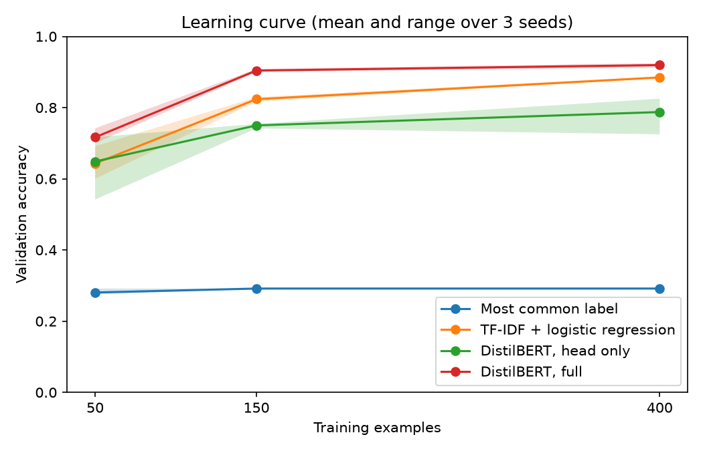
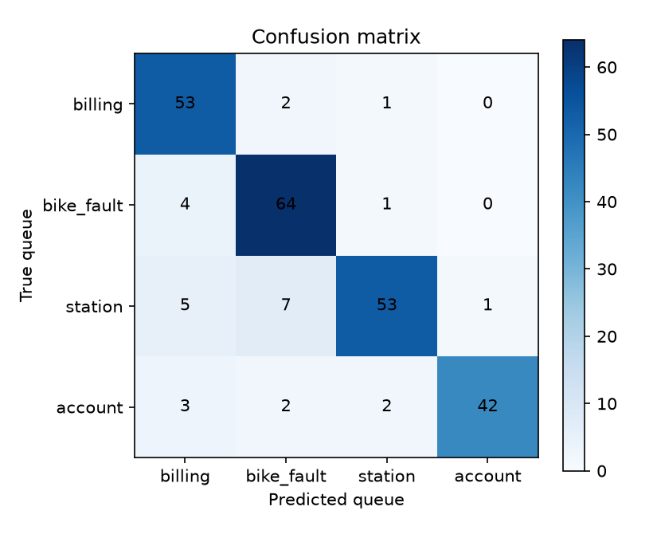

# Lakeshore Ticket Sorter: fine-tuning against a baseline

Model: https://huggingface.co/Gaelletheresa/lakeshore-ticket-sorter

Space: not published, because Hugging Face asked for a PRO subscription (see Publishing)

## What it does

Lakeshore Bike Share sorts support messages by hand into four queues: billing, bike_fault, station and account. This project asks whether fine-tuning DistilBERT on a few hundred labelled messages beats a simple TF-IDF baseline, and by how much. It compares the methods on the same rows, over three seeds, and reports the result even where it is unflattering. A Gradio app shows a score for every queue.

## How to run it (conda, the experiment script, the app, pytest)

Create and activate the environment:

```
conda env create -f environment.yml
conda activate lab09-fine-tune-and-publish
```

Run the whole experiment grid (3 sizes, 3 seeds, 4 methods; 30 to 60 minutes). It writes `reports/results.csv`, `reports/epoch_log.csv` and `reports/learning_curve.png`:

```
python run_experiments.py
```

Run the final check once. It trains the final model, scores the test rows and my 40 messages, writes `reports/final.json` and `reports/confusion_matrix.png`, and saves the model to `model/`:

```
python run_experiments.py --final
python share.py
```

`model/` is about 250 MB and is not in GitHub. Running the two commands above recreates it, and `share.py` writes the model card into it. `python tune.py` recreates `reports/tuning.csv`.

Start the app locally (it loads the `model/` folder):

```
python app.py
```

Run the tests and the style checks:

```
python -m ruff format --check .
python -m ruff check .
python -m pytest
```

The first run downloads the base model, so it needs an internet connection.

## Data and split

`tickets_data.py` is given and unchanged. `make_tickets()` with its default arguments makes 1,200 invented messages. About one message in eight says nothing about its topic, and about one in ten mixes two topics, so no model can reach 100%. The rows are split once, stratified 60/20/20 with a fixed seed, into 720 training, 240 validation and 240 test rows. Small training samples (50, 150 and 400 rows) are drawn from the training rows only, with the same stratified function for every method.

## Methods (baselines, fine-tuning settings and how you chose them)

- **Most common label:** predicts the most common training label.
- **TF-IDF + logistic regression:** word and word-pair features, fitted on the sampled rows only.
- **DistilBERT, head only:** `distilbert/distilbert-base-uncased` with the body frozen and only the new classification layers trained.
- **DistilBERT, full:** the same model with all weights trained.

All methods use the same sampled rows and are scored on the same validation rows, for seeds 0, 1 and 2. Fine-tuning uses AdamW, batch size 16, messages truncated at 64 tokens and each batch padded to its longest message. The seed controls the sample, the new head and the batch order.

Settings were chosen on the validation rows only: 150 training rows and seed 0, learning rates 1e-3 and 5e-3 for the head and 2e-5 and 5e-5 for the full model, 6 epochs each (`reports/tuning.csv`). The choice was head: learning rate 5e-3, 5 epochs; full: learning rate 5e-5, 4 epochs. These were tuned on one size and one seed, and the TF-IDF baseline was not tuned.

## Results (table over seeds, curve, final scores)

Validation accuracy, mean over 3 seeds (range in brackets):

| Training rows | Most common | TF-IDF | DistilBERT head only | DistilBERT full |
|---|---|---|---|---|
| 50 | 0.281 (0.275 to 0.292) | 0.643 (0.600 to 0.692) | 0.649 (0.542 to 0.717) | 0.717 (0.700 to 0.742) |
| 150 | 0.292 (0.292 to 0.292) | 0.824 (0.817 to 0.829) | 0.750 (0.742 to 0.754) | 0.904 (0.900 to 0.908) |
| 400 | 0.292 (0.292 to 0.292) | 0.885 (0.883 to 0.888) | 0.788 (0.725 to 0.825) | 0.919 (0.912 to 0.925) |



Final method, chosen on validation: DistilBERT full, trained on 400 rows (seed 0). Test rows were scored once (240 messages):

| Method | Accuracy | Macro F1 |
|---|---|---|
| DistilBERT, full | 0.883 | 0.885 |
| TF-IDF | 0.867 | 0.870 |
| Most common label | 0.288 | 0.112 |



On the test rows the fine-tuned model leads TF-IDF by 0.017, about 4 messages out of 240, from one seed. That is a small lead, and I cannot call it a clear win at this size.

## Your own 40 messages

I wrote 40 messages, ten per queue, in my own words, with a mix of short and long ones and some spelling slips (`data/own_messages.csv`). They were never used for training or for choosing settings, and were scored once:

| Method | Accuracy | Macro F1 |
|---|---|---|
| DistilBERT, full | 0.925 | 0.925 |
| TF-IDF | 0.800 | 0.790 |
| Most common label | 0.250 | 0.100 |

The fine-tuned model got 37 of 40 right and TF-IDF got 32. My messages contain no vague or mixed messages, so they are easier than the generated test rows, and 40 messages is a small set.

## Publishing

The fine-tuned model and its model card are on the Hugging Face Hub: https://huggingface.co/Gaelletheresa/lakeshore-ticket-sorter (`python publish.py`). The model weights are not in GitHub. The Space files are in `space/`. When I ran `python publish.py --space`, Hugging Face refused to create the Gradio Space with the error 402 Payment Required, because hosting a Gradio Space on free hardware needs a PRO subscription. I am showing the app running locally instead, as agreed with the instructor.

## Tests

`tests/` has 14 test functions, which runs as 18 tests because two of them are parametrized. They cover the split sizes and no overlap (parametrized over seeds), the small-sample function, TF-IDF beating the most common label, truncation and labels, freezing the body, head-only training leaving the body unchanged, full training changing it, repeating a run with the same seed, memorizing a small batch, saving and reloading a model, the model card headings, and the app (scores sum to one, clear message for empty text).

## Limitations

The training text was invented and repeats a small set of sentence patterns, so real customers will write differently and real accuracy is likely lower. One message in eight in the data cannot be labelled from its text. The comparison uses three seeds and one test set. Settings were chosen on one size and one seed. The test rows were used once.
